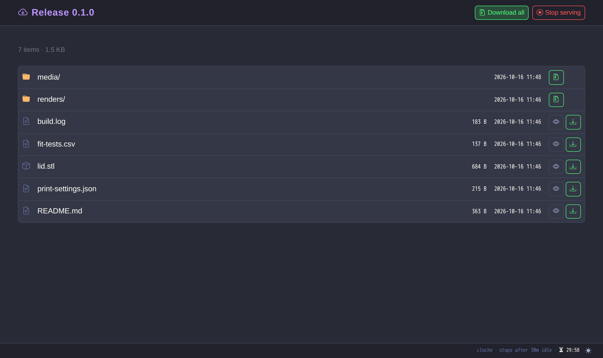
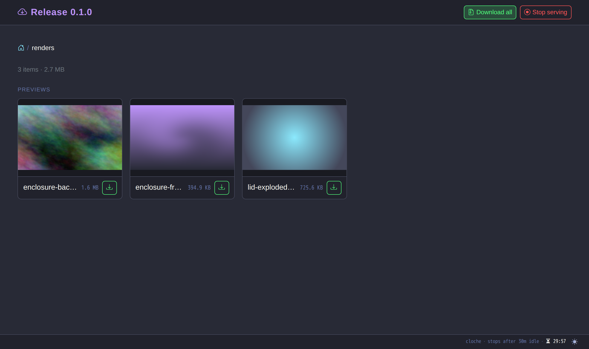
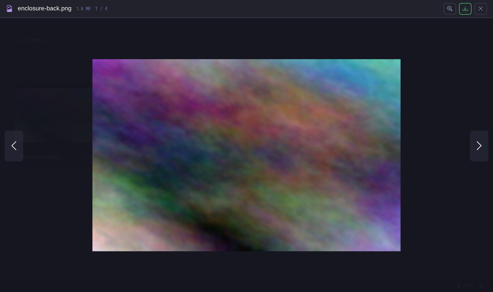
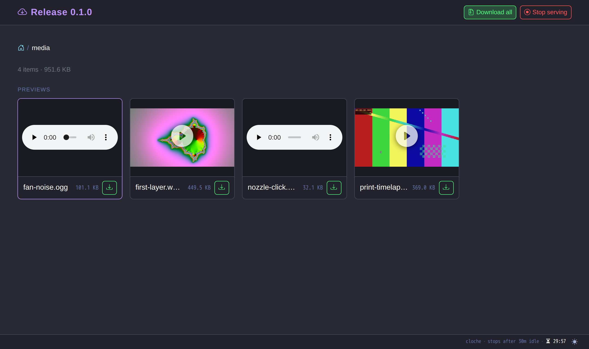
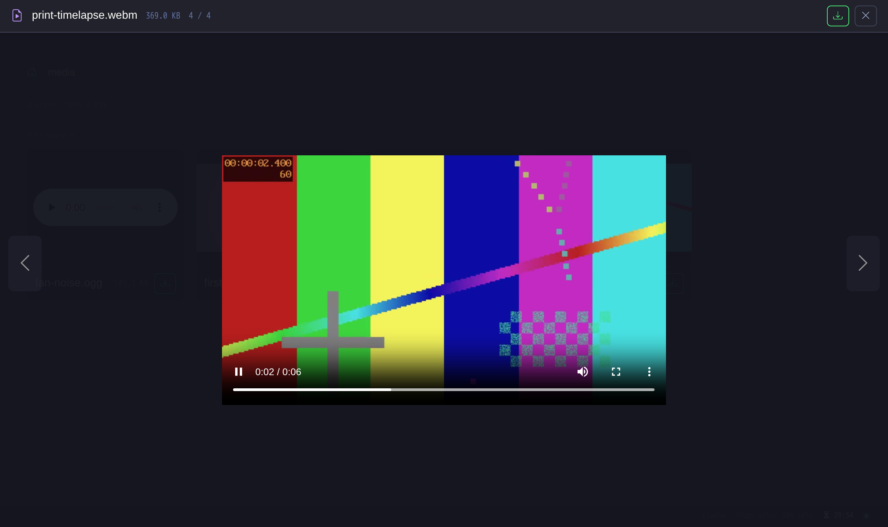
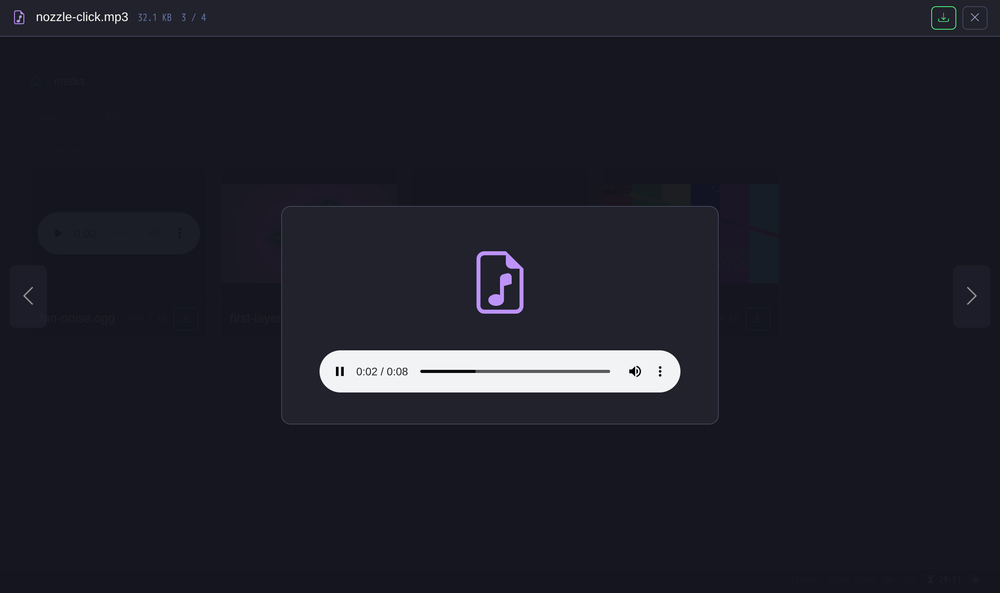
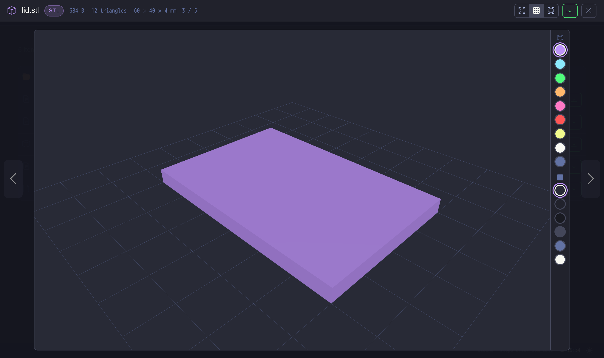
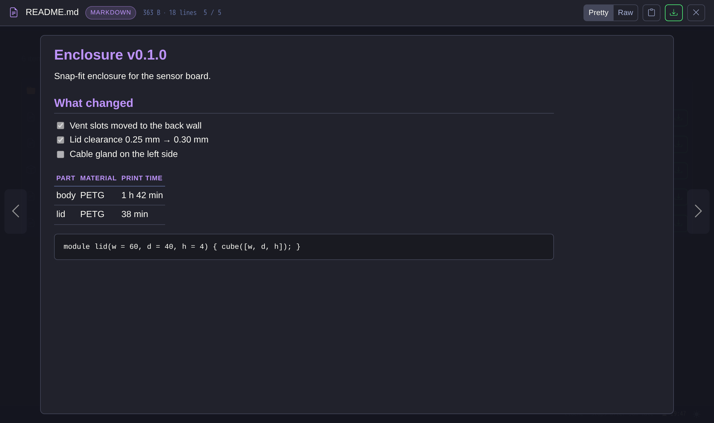
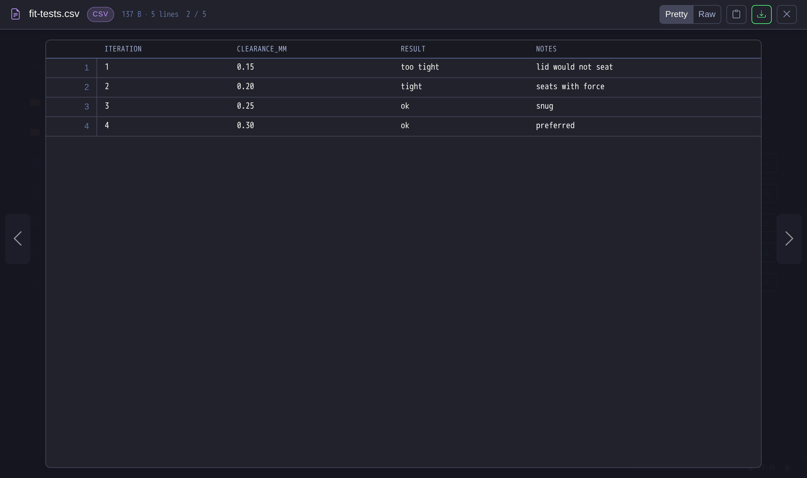
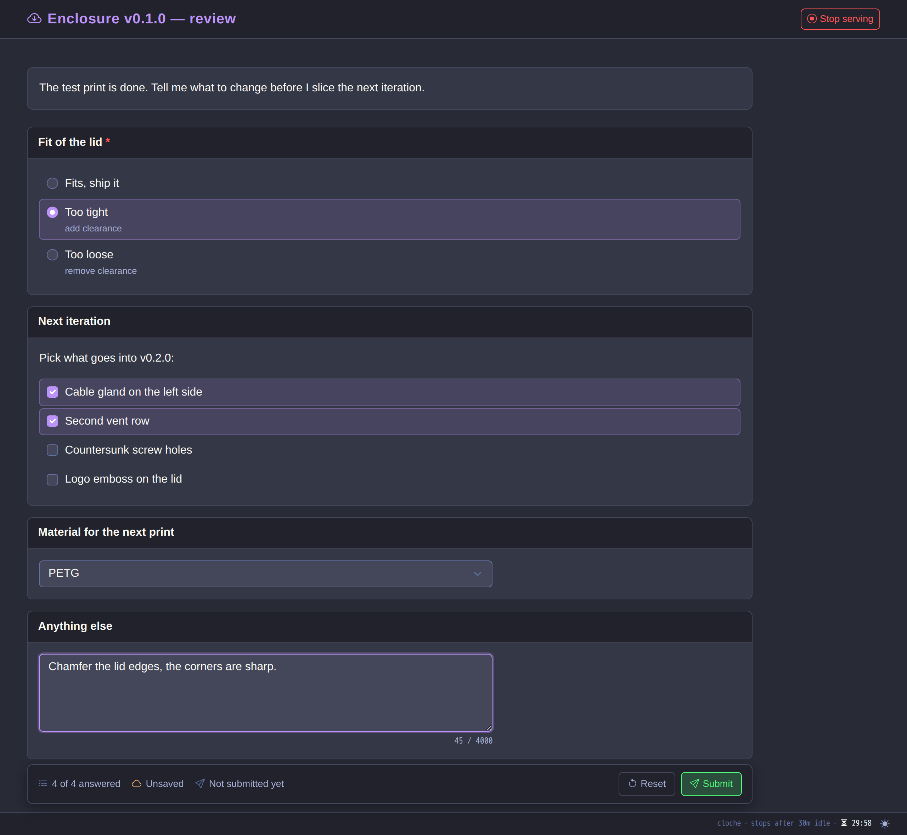

# cloche

[](https://github.com/rojosinalma/cloche/actions/workflows/publish-image.yml)
[](https://github.com/rojosinalma/cloche/actions/workflows/run-tests.yml)
[](https://github.com/rojosinalma/cloche/releases)
[](LICENSE)



| | |
|---|---|
|  **Images** — a folder of renders as a thumbnail grid |  **Image preview** — fit or actual size, ←/→ through the folder |
|  **Video and audio** — frame previews and inline players |  **Video preview** — plays in the modal, Download beside it |
|  **Audio preview** — same modal, native player |  **3D models** — STL/3MF/OBJ with grid, wireframe, colour rail and dimensions |
|  **Text: Markdown** — rendered, with a Raw toggle and Copy |  **Text: CSV** — tables; JSON pretty-printed, source highlighted |
|  **Forms** — radio, checklist, task list, select and free text; answers reach the agent on Submit | |

Hand files from an AI coding agent's machine to your browser, and get told when you looked at them.

An agent creates a **share** (REST or MCP) of files and folders by absolute host path and gives you a
link. You open a gallery page where almost anything previews in one modal, with tabs when a file has
more than one view: images, video, audio, highlighted text, Markdown, CSV, HTML pages (sandboxed), PDFs,
Jupyter notebooks, Mermaid and Graphviz diagrams, JSON/YAML/TOML trees, archive listings, diffs,
coloured terminal logs, maps (GeoJSON, GPX, KML), 3D models (STL, 3MF, OBJ, glTF, STEP) and G-code
toolpaths. Every file downloads on its own
or as a streamed zip, and a download log records what went out. A share can also be a **form**
(checklists, radio/select, free text, Markdown task lists) that you answer in the browser, or a **raw**
static site served from one folder. An **external link** passes a share on read-only to people
outside your gateway: its own expiring, revocable URL, created from the share page or by the agent.
Shares end after an idle timeout (configurable per share, or never). When a share ends or a form is submitted, the agent's [opencode](https://opencode.ai) session
gets a silent note saying how it ended, what you downloaded or what you answered. The MCP server
means agents need no curl and pass no session id. Named after the dome a waiter lifts off the plate.

Configuration, API, MCP tools, operations, security and development notes live in [`docs/`](docs/).

## Requirements

- Docker Engine 24 or later with Docker Compose v2 (the image `ghcr.io/rojosinalma/cloche` is
  published for linux/amd64 and linux/arm64)
- A browser with ES modules and WebGL (WebGL only for the 3D viewer); the UI is built on
  [tailor](https://github.com/rojosinalma/tailor) (vendored, icons from its Bootstrap Icons sprite) and loads
  the viewer libraries (three.js, Mermaid, Viz.js, Leaflet, togeojson) from jsDelivr at pinned versions
- For callbacks: an [opencode](https://opencode.ai) 2.0 or later server reachable from the container
- Optional, for STEP previews: a [cad-render](https://github.com/rojosinalma/cad-render) service
  (`step_view_cad_render_url`); map tiles come from OpenStreetMap unless you change `geo_view_tile_url`
- From source only: Ruby 3.3 or later, Bundler 2, and the `zip`, `tar`, `gzip`, `bzip2`, `xz` and `7z` binaries

## Installation

```sh
git clone https://github.com/rojosinalma/cloche.git
cd cloche
cp .env.example .env
```

Edit `.env`: set `HOST_HOME` (e.g. `/home/you`) and `CLOCHE_MCP_TOKEN` (`openssl rand -hex 32`);
set `OPENCODE_SERVER_PASSWORD` if you want callbacks. The container runs as uid 1000; if your account
has another uid, set `CLOCHE_UID`/`CLOCHE_GID` (see [`docs/operations.md`](docs/operations.md)). Then:

```sh
docker compose up -d        # pulls ghcr.io/rojosinalma/cloche:latest (or builds with --build)
```

Data (SQLite) lives in `./data`.

## Usage

Create a share:

```sh
curl -s http://localhost:9292/api/shares \
  -H "Authorization: Bearer $CLOCHE_MCP_TOKEN" \
  -H "Content-Type: application/json" \
  -d '{"paths": ["/home/you/some/folder"], "title": "Build output"}'
```

```json
{ "ok": true, "message": "Share created", "id": "kX3…", "url": "http://localhost:9292/s/kX3…/", "…": "…" }
```

Open `url` in the browser. To let an agent create shares itself, register the MCP server as described
in [`docs/opencode.md`](docs/opencode.md); the tools are listed in [`docs/mcp.md`](docs/mcp.md).

## Development

```sh
bundle install
RACK_ENV=development bundle exec puma -C config/puma.rb    # live reload, http://localhost:9292
ruby -wc app.rb config.ru lib/*.rb models/*.rb db/migrations/*.rb
```

There is no automated test suite yet; CI runs the syntax check and validates `compose.yaml`. Live
reload in Docker, layout and smoke tests are in [`docs/development.md`](docs/development.md); how to
contribute is in [`CONTRIBUTING.md`](CONTRIBUTING.md).

## License

Copyright (C) 2026 rojosinalma. Licensed under the [GNU Affero General Public License v3.0](LICENSE)
(AGPL-3.0-only).
